# OLIST ECOMMERCE ANALYSIS

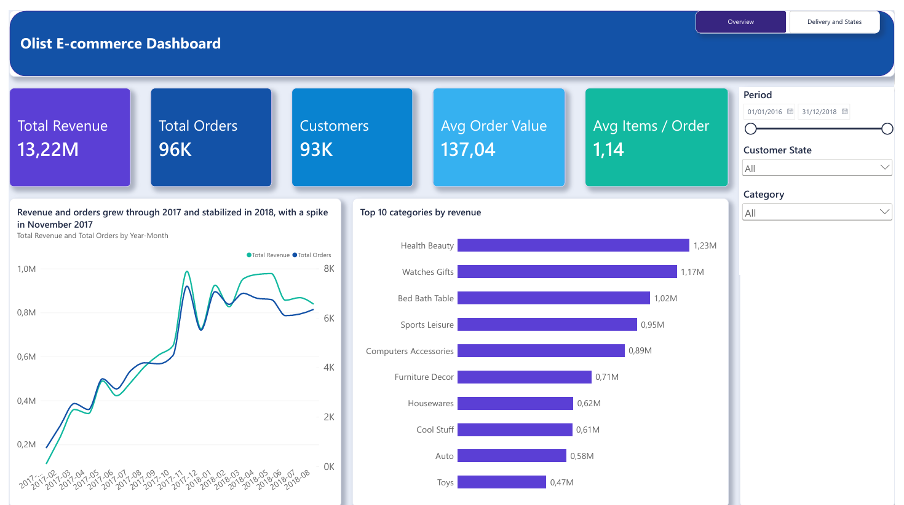

---

**Tools used** Python (pandas), PostgreSQL, Power BI

[Dataset used (Kaggle)](https://www.kaggle.com/datasets/olistbr/brazilian-ecommerce)

[Data exploration notebook](Notebook/Visualizing_tables.ipynb)

[SQL code](SQL)

[Power BI dashboard (.pbix)](Power%20Bi/dashboard.pbix)

## **Business Problem**

Olist is a Brazilian marketplace that connects small businesses to the main ecommerce channels. The company has about 100,000 orders placed between 2016 and 2018, spread across 9 related tables (orders, items, payments, reviews, customers, sellers, products, categories and geolocation).

The goal is to turn this data into insights that support business decisions. In particular, the analysis looks at how sales evolve over time, which product categories and states drive revenue, how customers behave and, above all, how **delivery performance** affects **customer satisfaction**.

## **Solution Plan**

1. **Exploration (Python).** A first look at the 9 raw tables with pandas, to understand their structure, size and missing values.
2. **Database (PostgreSQL).** Design of the relational schema, creation of the tables with primary keys, and loading of the raw CSV files.
3. **Data cleaning (SQL).** Data quality checks and documented decisions for every issue found. Foreign keys are added at the end as a final consistency check.
4. **Views (SQL).** Two views ready for analysis, one row per order and one row per item, so that every analysis starts from clean and consistent data.
5. **Analysis (SQL).** 9 business questions answered with SQL queries.
6. **Dashboard (Power BI).** An interactive report on two pages, connected to the SQL views, with DAX measures checked against the SQL results.

## **Database Schema**

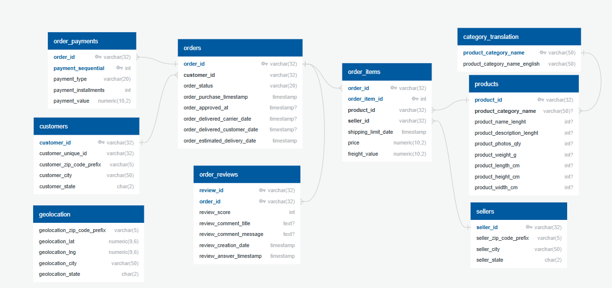

`orders` is the central table. `order_items`, `order_payments` and `order_reviews` have composite primary keys, while `geolocation` is not linked directly because each zip code prefix appears many times (it is aggregated during cleaning).

## **Data Cleaning**

Every check in [`02_cleaning.sql`](SQL/02_cleaning.sql) is followed by its result and by the decision taken.

| Issue found | Decision |
|---|---|
| 8 orders marked as *delivered* without a delivery date | Kept, but excluded from delivery time analyses |
| 610 products without a category | Assigned to a new category `unknown` |
| 2 categories without an English translation | Missing translations added |
| 789 `review_id` linked to more than one order | Legitimate (one review for several orders bought together), no changes |
| 547 orders with more than one review | All reviews kept, reduced to one average score per order in the views |
| About 1M geolocation rows for 19,015 zip code prefixes | New table `geolocation_zip` with one row per prefix (average coordinates) |
| 9 payments with value 0 | Legitimate (vouchers and undefined payments), no changes |
| Delivery before purchase, prices of zero or less | No inconsistencies found |

After cleaning, all foreign keys were created without errors, confirming that the tables are consistent with each other.

Two views were then created in [`03_views.sql`](SQL/03_views.sql). The first, `vw_orders`, has one row per order, with customer state, delivery days, a flag for late deliveries, average review score and order value. The second, `vw_order_items`, has one row per item, with English category, price, freight and seller state.

## **Execution**

All the analyses include only *delivered* orders, and revenue is the sum of item prices (freight excluded).

**Questions Answered from the Dataset**

**1) What are the total revenue, number of orders and number of unique customers?**

```sql
SELECT SUM(items_value)                   AS tot_rev,
       COUNT(order_id)                    AS num_ord,
       COUNT(DISTINCT customer_unique_id) AS num_cust
FROM vw_orders
WHERE order_status = 'delivered';
```

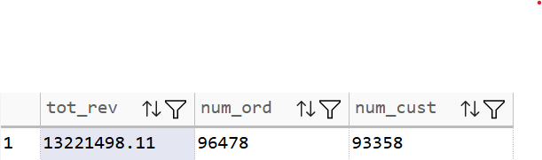

The business generated about **13.2M** in revenue from **96,478** delivered orders and **93,358** unique customers. The two numbers are very close, which means that almost every customer placed only one order.

**2) What is the Average Order Value (AOV) and the average number of items per order?**

```sql
SELECT ROUND(AVG(items_value), 2) AS AOV,
       ROUND(AVG(n_items), 2)     AS avg_num_items_per_order
FROM vw_orders
WHERE order_status = 'delivered';
```

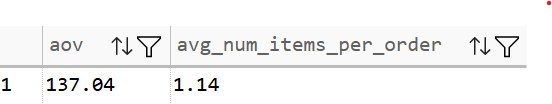

The average order is worth **137.04** and contains **1.14** items, so customers usually buy a single product per order.

**3) How do revenue and number of orders evolve month by month?**

```sql
SELECT DATE_TRUNC('month', order_purchase_timestamp)::date AS month,
       ROUND(SUM(items_value), 2)                          AS rev,
       COUNT(order_id)                                     AS num_orders
FROM vw_orders
WHERE order_status = 'delivered'
GROUP BY DATE_TRUNC('month', order_purchase_timestamp)
ORDER BY month;
```

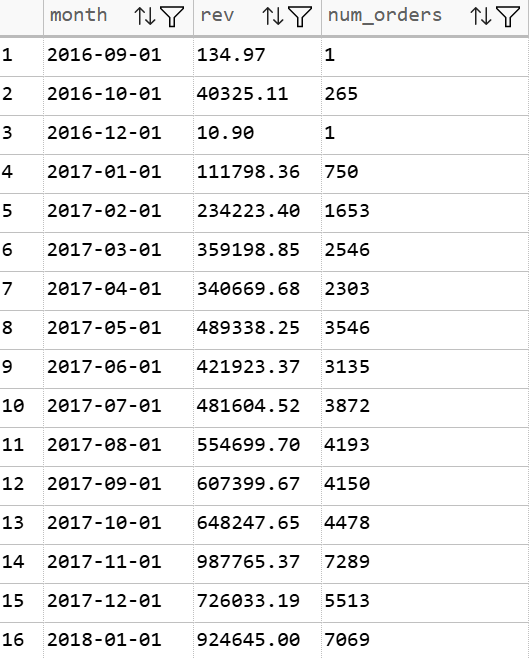

The months of 2016 have very few orders (1 in September, 1 in December, none in November), so this period is incomplete and not representative. During 2017 the business grows steadily, from about 112k in January to over 900k in early 2018, and in 2018 revenue stabilizes. The highest peak is in **November 2017** (7,289 orders, about 988k revenue), most likely due to Black Friday.

**4) Which product categories sell the most items?**

```sql
SELECT category,
       COUNT(*) AS num_items
FROM vw_order_items
WHERE order_status = 'delivered'
GROUP BY category
ORDER BY num_items DESC
LIMIT 10;
```

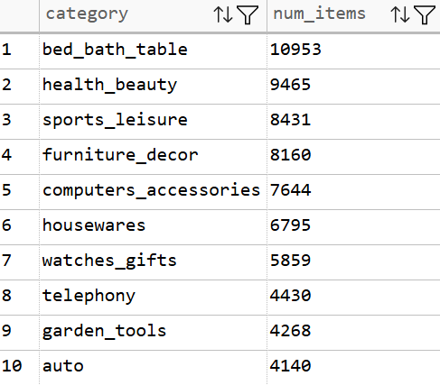

The top 3 categories by items sold are **bed_bath_table** (10,953), **health_beauty** (9,465) and **sports_leisure** (8,431). Three of the top 10 categories are related to the home (bed_bath_table, furniture_decor, housewares).

**5) Which product categories generate the highest revenue?**

```sql
SELECT category,
       SUM(price) AS rev
FROM vw_order_items
WHERE order_status = 'delivered'
GROUP BY category
ORDER BY rev DESC
LIMIT 10;
```

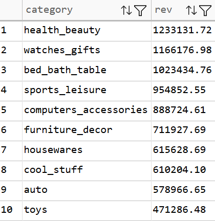

**health_beauty** leads revenue (about 1.23M). **watches_gifts** is only 7th in items sold but 2nd in revenue (about 1.17M), because its products are expensive (about 199 per item). On the contrary, **bed_bath_table** sells the most items but drops to 3rd place, because its products are cheaper (about 93 per item). Revenue therefore depends both on volume and on price.

**6) Which states have the customers who spend the most, in total and on average per customer?**

```sql
SELECT customer_state,
       SUM(items_value)                                                AS rev_per_state,
       ROUND(SUM(items_value) / COUNT(DISTINCT customer_unique_id), 2) AS avg_rev_per_customer,
       COUNT(DISTINCT customer_unique_id)                              AS n_customers
FROM vw_orders
WHERE order_status = 'delivered'
GROUP BY customer_state
ORDER BY rev_per_state DESC
LIMIT 10;
```

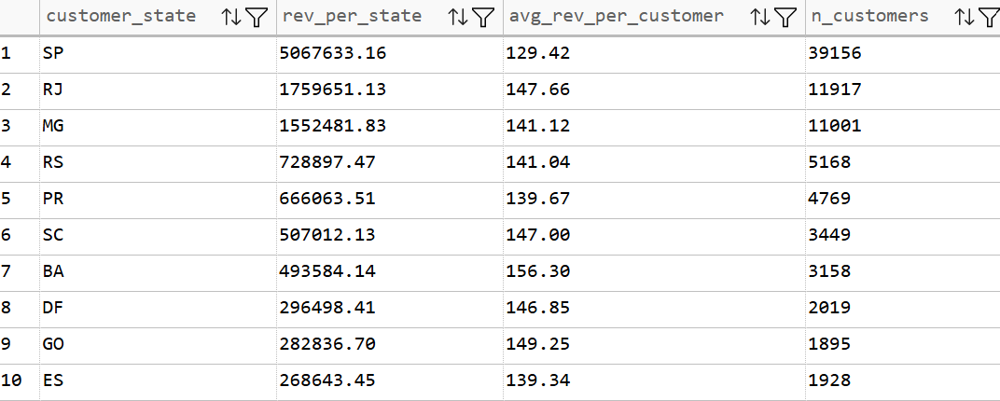

**São Paulo (SP)** generates about 38% of total revenue (about 5.07M) because it has by far the most customers (about 42% of the total). However, its average spend per customer (129.42) is the lowest in the top 10. **Bahia (BA)** is 7th in total revenue but has the highest average spend per customer in the top 10 (156.30).

**7) How can customers be segmented by Recency, Frequency and Monetary value (RFM analysis)?**

```sql
WITH rfm_base AS (
    SELECT customer_unique_id,
           (SELECT MAX(order_purchase_timestamp)
            FROM vw_orders
            WHERE order_status = 'delivered')::date
           - MAX(order_purchase_timestamp)::date AS recency,
           COUNT(order_id)                        AS frequency,
           ROUND(SUM(items_value), 2)             AS monetary
    FROM vw_orders
    WHERE order_status = 'delivered'
    GROUP BY customer_unique_id
),

rfm_scores AS (
    SELECT customer_unique_id,
           NTILE(5) OVER (ORDER BY recency DESC)    AS r_score,
           CASE WHEN frequency = 1 THEN 1 ELSE 2 END AS f_score,
           NTILE(5) OVER (ORDER BY monetary)        AS m_score
    FROM rfm_base
),

rfm_segments AS (
    SELECT customer_unique_id,
           CASE
               WHEN r_score >= 4 AND m_score >= 4 THEN 'Champions'
               WHEN f_score = 2                   THEN 'Loyal'
               WHEN r_score <= 2 AND m_score >= 4 THEN 'At risk'
               WHEN r_score <= 2 AND m_score <= 2 THEN 'Lost'
               WHEN r_score >= 4                  THEN 'New'
               ELSE 'Others'
           END AS segment
    FROM rfm_scores
)

SELECT segment,
       COUNT(*) AS n_customers
FROM rfm_segments
GROUP BY segment
ORDER BY n_customers DESC;
```

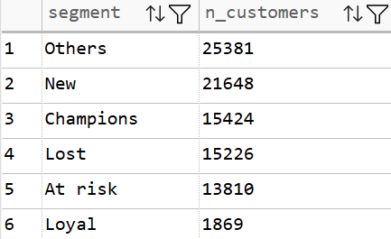

Recency and Monetary value are scored from 1 to 5, while Frequency was reduced to two levels (1 order or more than 1 order), because almost all customers have only one order.

Only **about 2%** of customers are *Loyal*. Almost all customers buy only once, so **customer retention is Olist's main weakness**. In addition, **13,810** customers are *At risk*. They spent a lot but have not bought for a long time, which makes them the most valuable target for a campaign to win them back.

**8) Which states have the highest percentage of late deliveries?**

```sql
SELECT customer_state,
       ROUND(AVG(is_late) * 100, 2) AS pct_late_del,
       COUNT(order_id)              AS num_orders_per_state
FROM vw_orders
WHERE order_status = 'delivered'
GROUP BY customer_state
ORDER BY pct_late_del DESC;
```

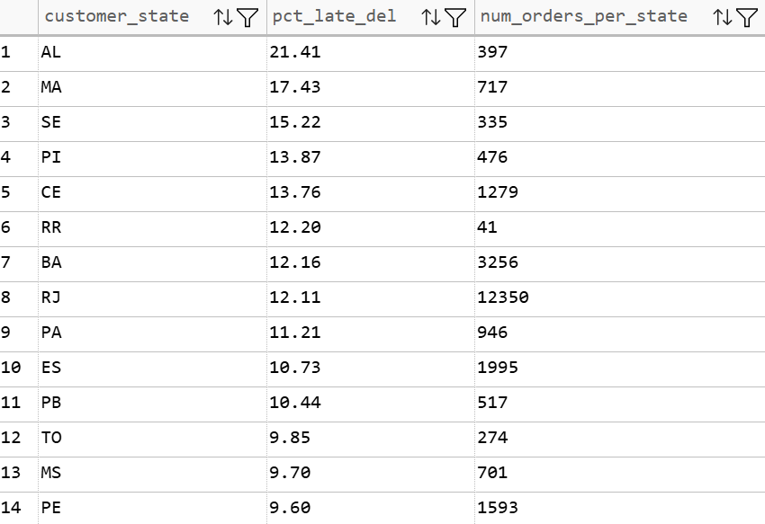

The highest rates of late deliveries are in **Alagoas (21.41%)**, **Maranhão (17.43%)** and **Sergipe (15.22%)**, all states with relatively few orders. They are all in the North East of Brazil, far from São Paulo where most sellers are located. Distance could therefore be a cause of the delays (hypothesis). São Paulo, with the most orders, has only 4.49% of late deliveries.

**9) Do late deliveries receive worse review scores than on time deliveries?**

```sql
SELECT CASE
           WHEN is_late = 0 THEN 'On time'
           WHEN is_late = 1 THEN 'Late'
       END                          AS order_state,
       ROUND(AVG(avg_rev_score), 2) AS avg_rev_score,
       COUNT(order_id)              AS num_orders
FROM vw_orders
WHERE order_status = 'delivered'
  AND is_late IS NOT NULL
GROUP BY order_state;
```

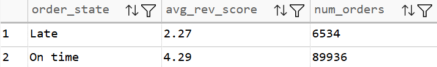

On time orders receive an average score of **4.29**, late orders only **2.27**, about **2 points lower** on a scale from 1 to 5. Late orders are 6.8% of delivered orders. Delivery punctuality is strongly associated with customer satisfaction.

## **Power BI Dashboard**

The dashboard is connected directly to the PostgreSQL views, with a calendar table, DAX measures and synchronized slicers (period, customer state, category). All KPIs were checked against the SQL results.

**Page 1, Overview.** Main KPIs, monthly trend of revenue and orders, top 10 categories by revenue.


**Page 2, Delivery and States.** Delivery and satisfaction KPIs, late deliveries by state, review score on time vs late, revenue by state.

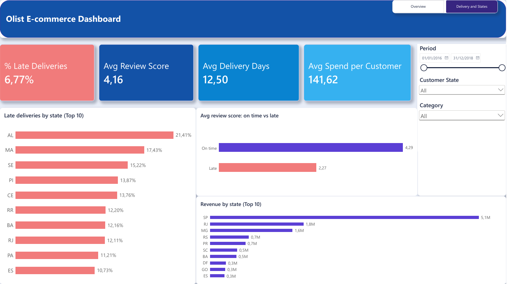

*Note. When filtering by category, the KPIs refer to orders containing at least one product of that category.*

## **Conclusion**

**Growth.** The business grew strongly during 2017 and stabilized in 2018, with a clear peak in November 2017 (Black Friday). Revenue growth comes from more orders, not from higher spending per order, which stays stable.

**Products.** Health and beauty, watches and gifts and home related categories drive revenue. High priced categories can generate high revenue even with fewer items sold.

**Geography.** São Paulo is by far the largest market, but customers in other states spend more on average per person.

**Customers.** Almost all customers buy only once. Improving retention, starting from the *At risk* segment, is the biggest growth opportunity.

**Delivery and satisfaction.** Late deliveries receive reviews about 2 points lower, and delays are concentrated in the North Eastern states. Improving logistics in these regions could significantly increase customer satisfaction.

## **Limitations**

The data covers the period from 2016 to 2018, and the first and last months are incomplete. Product costs are not available, so the analysis measures revenue, not profit. Finally, the link between delays and lower reviews is a strong association, and this analysis alone cannot prove causation.

## **Repository Structure**

```
├── Notebook/          # first exploration with pandas
├── SQL/
│   ├── 01_schema.sql      # tables and primary keys
│   ├── 02_cleaning.sql    # quality checks, cleaning, foreign keys
│   ├── 03_views.sql       # analysis views
│   └── 04_analysis.sql    # business questions
├── Power Bi/          # dashboard (.pbix) and custom theme
└── Images/            # schema, query results and dashboard screenshots
```

The raw CSV files are not included in this repository because of their size. They can be downloaded from [Kaggle](https://www.kaggle.com/datasets/olistbr/brazilian-ecommerce) and were loaded into PostgreSQL with the pgAdmin import tool (*Import/Export Data*).
